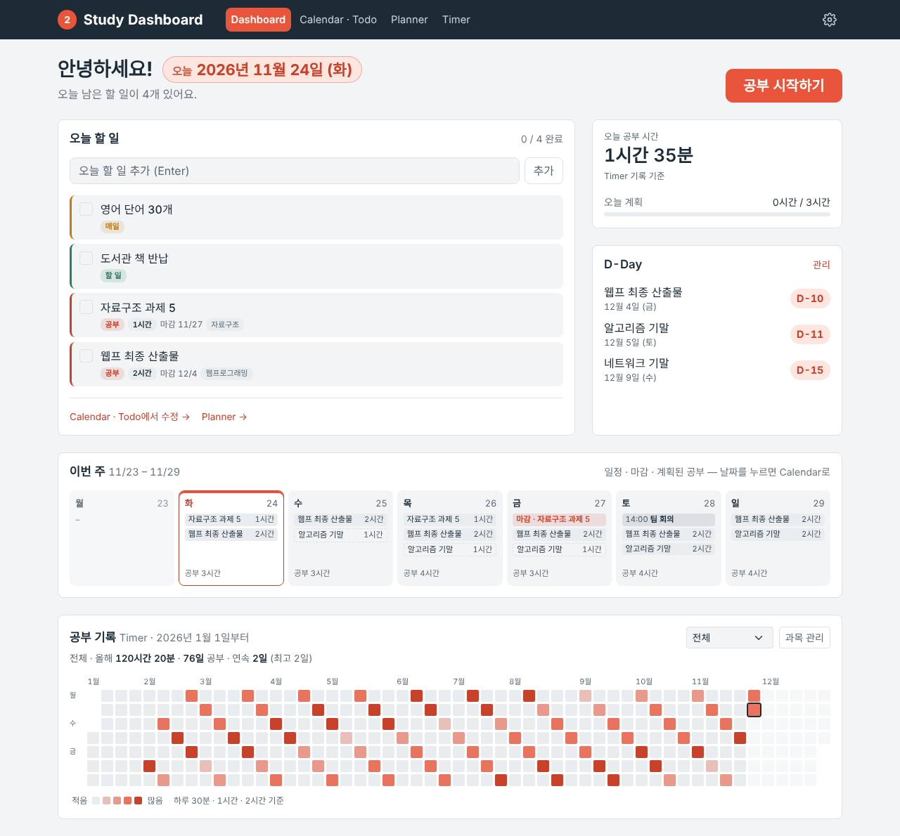
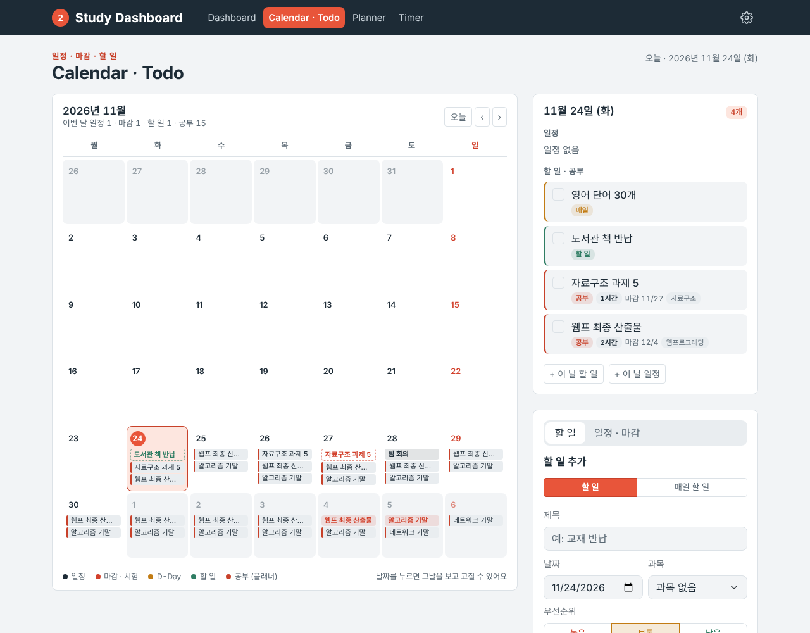
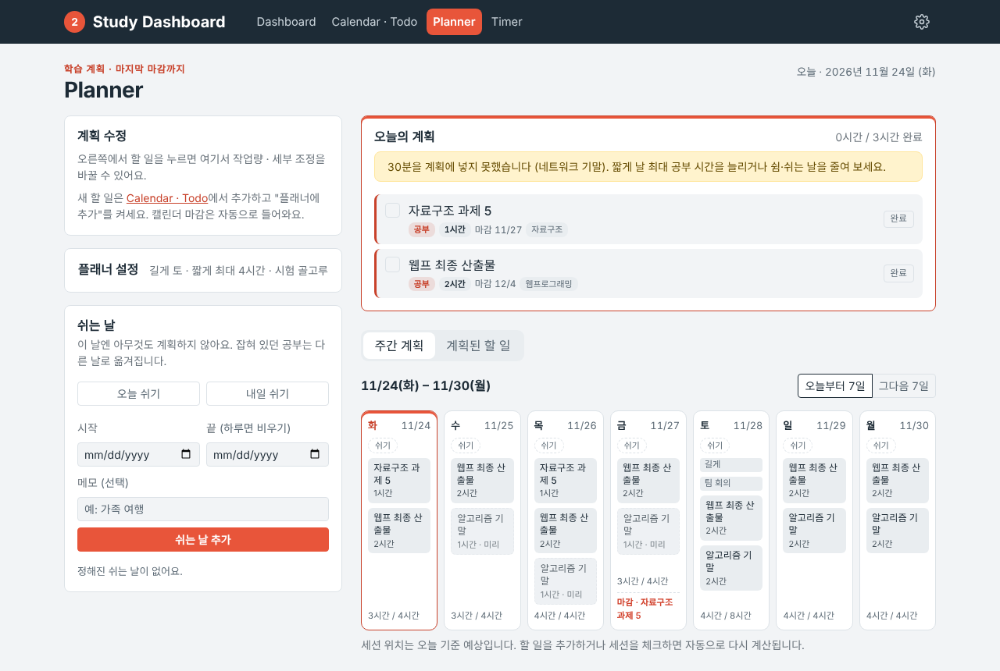
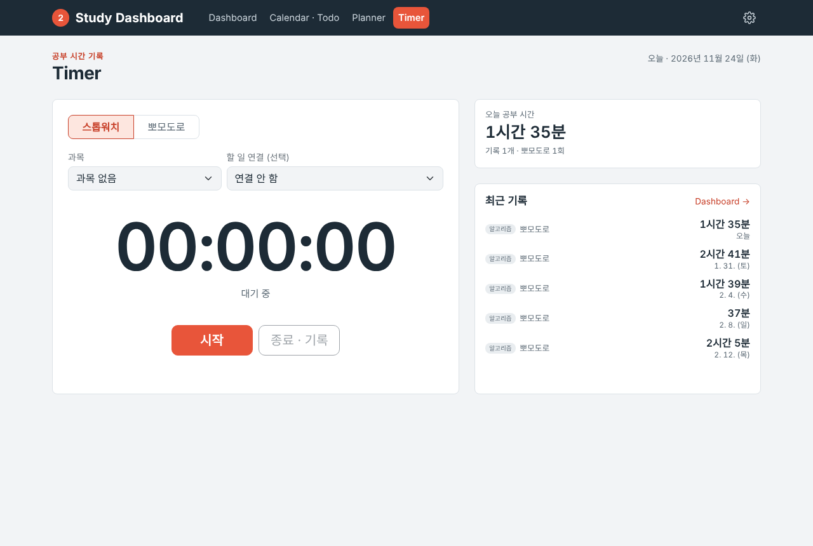
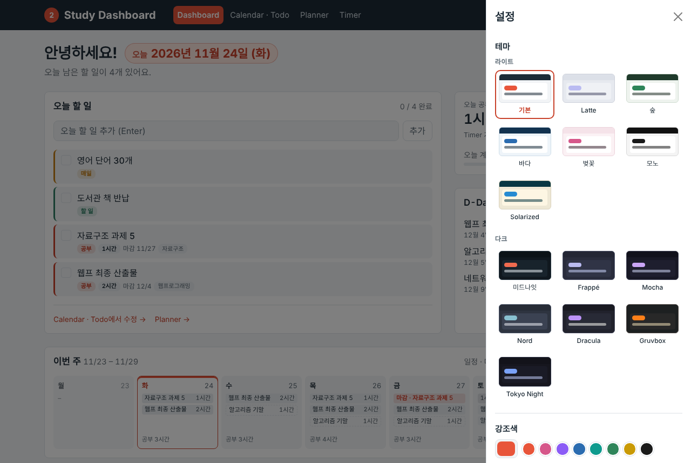
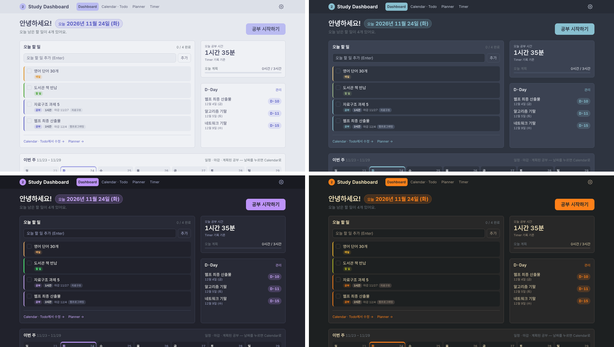
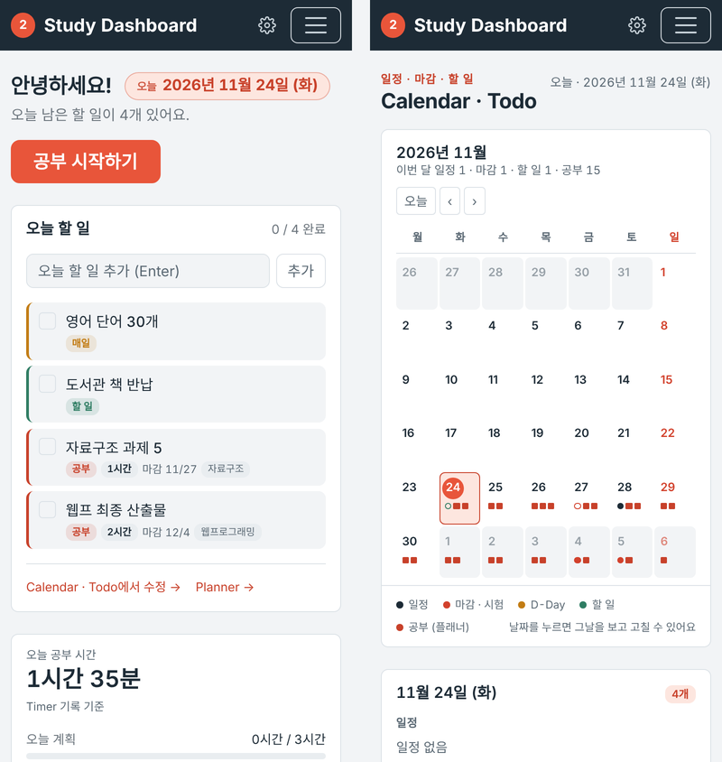

# Study Dashboard

마감과 시험을 넣으면 **매일 무엇을 몇 시간 공부할지 알아서 짜 주는** 학습 관리 웹사이트.
웹프로그래밍 (2026-2) 2팀 프로젝트 · HTML · CSS · JavaScript · Bootstrap 5 · 서버 없음



## 주요 기능

- **자동 학습 계획** — 할 일에 작업량(1~5)만 고르면 플래너가 마감 전에 공부 세션을 나눠서 배치. 시험은 가까워질수록 길게, 놓친 공부는 다음 날 보충.
- **캘린더 마감 → 계획 자동 연결** — Calendar에 시험 · 과제 마감을 넣으면 플래너에 바로 들어감.
- **시험 공부 방식 선택** — 골고루 (하루에 여러 과목) 또는 하루 한 과목 (예: 알고리즘 → 웹프 → CC 번갈아).
- **할 일 · 매일 할 일** — 그날만 하는 할 일, 매일 반복하는 할 일 (날마다 체크).
- **내 일주일 · 쉬는 날** — 요일별로 짧게 / 길게 / 쉼, 특정 날짜 쉬기 → 계획이 알아서 비켜 감.
- **Timer + 공부 잔디** — 스톱워치 · 뽀모도로로 공부 시간 기록, 1월 1일부터 GitHub 잔디처럼 표시 (전체 / 과목별).
- **테마 14개 + 꾸미기** — 라이트 7 · 다크 7, 강조색 · 글자 크기 · 모서리. 백업 파일 내보내기 / 가져오기.
- **반응형** — 휴대폰에서도 같은 기능.

## 화면

| Calendar · Todo | Planner |
|---|---|
|  |  |
| 월 달력에 일정 · 마감 · 할 일 · 계획된 공부. 날짜를 누르면 그날을 보고 고칠 수 있음. | 마지막 마감까지의 계획, 주간 보기, 내 일주일 · 쉬는 날 · 시험 공부 방식 설정. |

| Timer | 설정 (⚙) |
|---|---|
|  |  |

| 테마 (Latte · Nord · Dracula · Gruvbox) | 휴대폰 |
|---|---|
|  |  |

## 실행 방법

설치할 것 없음. 정적 파일만 있으면 됨 (Bootstrap · 글꼴은 CDN).

```bash
git clone https://github.com/msung0406/WPTeam2.git
cd WPTeam2
python3 -m http.server 8000      # 또는 VS Code Live Server
```
브라우저에서 `http://localhost:8000` 열기. 처음엔 비어 있음 → Planner의 **예시 데이터 불러오기**로 둘러볼 수 있음.

GitHub Pages로 그대로 배포 가능 (Settings → Pages → 브랜치 선택).

## 기술 스택

| 분류 | 사용 |
|---|---|
| 화면 | HTML5 · CSS3 (CSS 변수로 테마) · Bootstrap 5.3 · IBM Plex Sans KR |
| 동작 | JavaScript (ES2020, 빌드 도구 없음) |
| 저장 | 브라우저 localStorage (서버 · 로그인 없음, 백업은 JSON 파일) |
| 테스트 | Node.js 단위 테스트 (`node tests/run.js`) |

## 구조

```
index.html       Dashboard — 오늘 할 일 · 공부 시간 · 이번 주 · 공부 잔디
calendar.html    Calendar · Todo — 달력 · 일정 · 할 일 추가
planner.html     Planner — 학습 계획 · 플래너 설정 · 쉬는 날
timer.html       Timer — 스톱워치 · 뽀모도로
css/             style.css (테마 토큰 · 공통) · components.css · 페이지별 CSS
js/              storage.js (데이터) · planner.js (계획 알고리즘) · views.js · todoform.js · 페이지별 JS
tests/run.js     storage · planner 단위 테스트
docs/            개발 가이드
```

## 어떻게 동작하나

1. 모든 페이지는 `js/storage.js`(`SD`)를 통해서만 데이터를 읽고 씀 → 한 페이지에서 바꾸면 다른 페이지 · 다른 탭에도 바로 반영.
2. `js/planner.js`는 저장하지 않는 순수 함수. 할 일 · 일정 · 설정을 받아 오늘부터 마지막 마감까지 날짜별 세션을 계산하고, 화면이 열릴 때마다 다시 계산.
3. 시간을 직접 입력하지 않음 — 작업량 1~5와 종류(과제 · 시험 · 프로젝트)가 패턴을 정하고, 실제로 체크한 시간으로 다음 시험 계획을 보정.

자세한 데이터 형식 · 플래너 규칙 · 코드 규칙: **[docs/DEVELOPMENT.md](docs/DEVELOPMENT.md)**

## 팀

| 이름 | GitHub | 맡은 부분 |
|---|---|---|
| 김주환 | [@Zoenya](https://github.com/Zoenya) | Todo · Planner, 데이터 레이어(storage.js), 플래너 알고리즘, 공통 부품, 테마 · 설정 |
| 김지환 | [@jihwan2da](https://github.com/jihwan2da) | Main · Dashboard, 통합(integration) |
| 김도형 | [@ehgudrla](https://github.com/ehgudrla) | Calendar · D-Day |
| 김민성 | [@msung0406](https://github.com/msung0406) | Timer, 저장소 관리 |

## 앞으로

- 구글 캘린더 등 **캘린더 구독** — 브라우저만으로는 다른 사이트의 일정을 가져올 수 없어서(CORS) 서버가 필요
- 로그인 · 여러 기기 동기화
- 공부 기록을 바탕으로 계획을 더 똑똑하게 (AI 플래너)

## 크레딧

- [Bootstrap](https://getbootstrap.com) (MIT) · [IBM Plex Sans KR](https://github.com/IBM/plex) (OFL)
- 테마 색: [Catppuccin](https://catppuccin.com) (Latte · Frappé · Mocha), [Nord](https://www.nordtheme.com), [Dracula](https://draculatheme.com), [Gruvbox](https://github.com/morhetz/gruvbox), [Solarized](https://ethanschoonover.com/solarized/), [Tokyo Night](https://github.com/folke/tokyonight.nvim)
- 개발 과정에서 생성형 AI(Claude)의 도움을 받았음.
